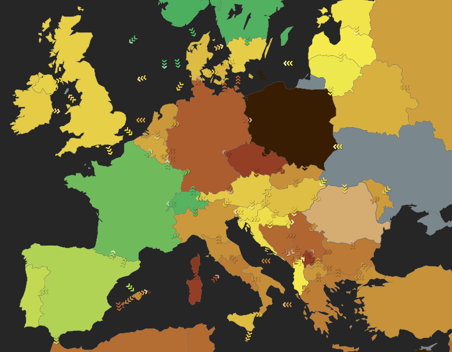

```{python}
#| include: false
import os
import warnings

# Quieten CodeCarbon before the first tracker is created.
os.environ["CODECARBON_LOG_LEVEL"] = "error"
warnings.filterwarnings("ignore")

import plotnine
import polars as pl

plotnine.options.figure_size = (7, 3.5)
plotnine.options.dpi = 110
pl.Config.set_tbl_hide_dataframe_shape(True)
```

## Description

This tutorial measures and compares the resource use of Python programs. This
is relevant because of the increased reliance of social science research on
computationally complex machine learning and AI methods such as large
language models [@balluff:2026:nlb], which may consume significantly more
non-renewable resources than computationally less advanced methods
[@hamiltonpalicki:2026:dlu; @luccioni:2024:phc].

It uses two open source Python libraries directly:
[CodeCarbon](https://codecarbon.io) [@courty:2026:codecarbon], for measuring
the energy of local programs, and [EcoLogits](https://ecologits.ai)
[@rince:2025:ecologits], for estimating the energy use of API calls to LLM
providers. Based on measuring time, energy, location, and, in the case of API
calls, the length of LLM responses, they provide estimates for equivalent
carbon emissions, and water use needed to run the program. It is the Python
counterpart of the TidyCarbon tutorial [@hamiltonpalicki:2026:tidycarbon],
which does the same analysis in R through a tidy interface over these two
libraries.

## Use Cases

- Track and report time, energy, carbon emissions, and water usage for
  computational analysis tasks.
- Track at macro and micro levels of a program: track a complete analysis, or
  track a pipeline step by step.
- Compare speed and energy use for alternative methods of analysis (e.g.
  different methods of sentiment analysis), providing data for reducing the
  computational effort and emissions of analyses.
- Estimate the energy use and emissions of LLM-based analyses on remote
  servers (OpenAI, Anthropic, Mistral).

## Important Functions

CodeCarbon tracks a whole script, a block of code, or each step of a
pipeline. EcoLogits estimates a single request to a hosted model.

### Function List

| Function | Purpose |
|---|---|
| `OfflineEmissionsTracker()` | Create a local tracker. Reads the machine's energy counters where it can (RAPL for the CPU, NVML for an NVIDIA GPU), and estimates the energy from the machine's specs where it cannot. See CodeCarbon for the methodology. |
| `llm_impacts()` | Estimate the impact of a request to an LLM provider. See EcoLogits for the methodology. |
| `tracker.start()` | Begin tracking energy. Place before the code to measure. |
| `tracker.stop()` | End tracking energy. Place after the code to measure. |
| `with OfflineEmissionsTracker() as tracker:` | Measure a block of code, such as a single function call. |
| `tracker.start_task()`, `tracker.stop_task()` | Measure one step of a pipeline, under a label of its own. |
| `carbon_bench()` | Directly compare the emissions of functions. Not part of CodeCarbon: it is written in this tutorial, from tasks. |
| `tracker.final_emissions_data` | The measurement of a tracker, once stopped. |

# Requirements and Installation

[uv](https://docs.astral.sh/uv/) creates the project, its virtual environment
and its lock file:

```bash
uv init austen-carbon
cd austen-carbon

uv add codecarbon ecologits polars pyarrow plotnine scikit-learn scipy nltk
uv add openai pydantic python-dotenv
```

polars holds the data and the measurements, and plotnine draws them.
scikit-learn [@pedregosa:2011:sklearn] fits the topic model, and NLTK
[@bird:2009:nltk] provides the stop words, the sentence tokenizer and the
second sentiment dictionary. openai and pydantic send the requests to the language model.
pyarrow is what plotnine uses to read a polars table.

Run a script with `uv run python script.py`. To work in a notebook instead,
add Jupyter and start it from the project:

```bash
uv add jupyter
uv run jupyter lab
```

The data are in the `data` folder next to this tutorial:
`data/austen_books.csv` has one row per printed line of Jane Austen's six
novels, and `data/bing.csv` is the Bing sentiment lexicon. Both were exported
from the R packages janeaustenr and tidytext by `data/make_data.R`, so the
data are the same as in the R tutorial.

## How to Use

### Initialize local tracking

The following examples demonstrate tracking the resources needed for
computation on a local system. Importantly, measurements are made at the level
of the machine. For accurate comparisons, ensure that no other compute- or
memory-intensive programs (e.g. browsers, long-running analysis tasks) are
running.

```{python}
#| eval: false
from codecarbon import OfflineEmissionsTracker

tracker = OfflineEmissionsTracker(
    project_name="Hello_World",
    output_dir="codecarbon_results",
    country_iso_code="DEU",
    log_level="error",
)
```

This creates a tracker. It measures nothing until it is started.

The project will be called `Hello_World` in the rows of the log. Each
measurement is appended to `codecarbon_results/emissions.csv`, which is
therefore the source of truth for all tracking done in the project.

`log_level="error"` quietens CodeCarbon, which otherwise prints a progress
line for every reading. Leave it out once to see which measurement method
CodeCarbon found for your hardware.

`EmissionsTracker` looks up the country the machine is in, with one request
to a geolocation service, to estimate the carbon intensity of its
electricity. `OfflineEmissionsTracker` with `country_iso_code` skips that
request.

Carbon intensity is the relationship between energy and the estimated amount
of carbon emitted to generate that electricity. It depends on the
sustainability of local power grids and varies greatly, as Figure 1 shows.
Countries such as France have a low carbon intensity because they generate a
higher proportion of their electricity from low-carbon sources (nuclear,
solar). In contrast, Germany and the US generate a higher proportion from
fossil fuels (coal, gas).

{width=80% fig-align="center"}

### Basic measurements of a Python program

We will demonstrate a standard text analysis, using examples from the
[Tidy Text Mining](https://www.tidytextmining.com) book [@silge:2017:tmr].

#### Load packages and data

We load the libraries and the Austen books.

```{python}
import os
import random
import sys
import tempfile
import time
from pathlib import Path

import nltk
import polars as pl
from codecarbon import OfflineEmissionsTracker
from plotnine import aes, coord_flip, geom_col, geom_jitter, geom_violin, ggplot, labs, theme, theme_minimal
from scipy.sparse import csr_matrix

# more advanced analyses downstream
from sklearn.decomposition import LatentDirichletAllocation
```

```{python}
austen_books = pl.read_csv("data/austen_books.csv").with_columns(
    pl.col("text").fill_null("")
)
```

The stop words are NLTK's standard English list [@bird:2009:nltk]. NLTK's
lists, lexicons and tokenizer models are data of their own, which NLTK
downloads once. Here they go into the project's virtual environment, one of
the folders NLTK searches:

```{python}
nltk.download(
    ["stopwords", "punkt_tab", "opinion_lexicon"],
    download_dir=f"{sys.prefix}/nltk_data",
    quiet=True,
)

from nltk.corpus import opinion_lexicon, stopwords
from nltk.tokenize import sent_tokenize, word_tokenize

stop_words = pl.DataFrame({"word": stopwords.words("english")})
```

Each tracker in this tutorial is created with the same settings, so keep them
in one place. A temporary folder holds the log here; use a folder of your own
to keep it after the session ends:

```{python}
log_dir = Path(tempfile.mkdtemp(prefix="codecarbon_results_"))

tracker_args = dict(output_dir=log_dir, country_iso_code="DEU", log_level="error")
```

Splitting text into words, and into sentences, is needed several times below,
so each gets a function of its own:

```{python}
def unnest_tokens(data, column):
    """Split text into words, one row each, like tidytext's unnest_tokens().

    The text is lower-cased, and a word is a run of letters and digits,
    with an apostrophe inside it kept ("don't").
    """
    return (
        data
        .with_columns(
            pl.col(column)
            .str.to_lowercase()
            .str.extract_all(r"[\p{L}\p{N}]+(?:'[\p{L}]+)*").alias("word")
        )
        .drop(column)
        .explode("word")
        .drop_nulls("word")
    )


def unnest_sentences(data, column):
    """Split text into sentences, one row each, like tidytext's unnest_sentences().

    NLTK's sentence tokenizer finds the sentences, and `id` numbers them
    from 1 in order.
    """
    return (
        data
        .with_columns(
            pl.col(column)
            .map_elements(sent_tokenize, return_dtype=pl.List(pl.String)).alias("sentence")
        )
        .drop(column)
        .explode("sentence")
        .with_row_index("id", offset=1)
        .with_columns(
            pl.col("id")
            .cast(pl.Int64)
        )
    )
```

For the first example, we start the tracker before a pipeline that counts the
top words in Austen's novels, and stop it afterwards. It is as simple as
placing the tracker before and after existing code.

#### Tracker start and stop

```{python}
tracker = OfflineEmissionsTracker(project_name="clean and count words", **tracker_args)
tracker.start()  # Start tracker

books = austen_books.with_columns(
    linenumber=pl.int_range(1, pl.len() + 1).over("book"),
    chapter=pl.col("text").str.contains(r"(?i)^chapter [\divxlc]").cum_sum().over("book"),
)

word_counts = (
    unnest_tokens(books, "text")
    .join(stop_words, on="word", how="anti")
    .group_by("book", "word")
    .len("n")
    .sort("n", descending=True)
)

tracker.stop()  # End tracker

word_counts
```

#### Output data

Every measurement is an object with one attribute per measure and per piece
of machine information. As a side effect, it is automatically appended to the
CSV file in the log folder.

`tracker.final_emissions_data` is now the carbon measurement. Turn it into a
one-row table. It has all of the columns returned by CodeCarbon, most of
which are not needed for downstream analysis. `glimpse()` shows all of them:

```{python}
books_emit = pl.DataFrame([vars(tracker.final_emissions_data)])

books_emit.glimpse()
```

The results include estimates of time, hardware-level energy consumption,
aggregated energy consumption and an estimate of emissions. `duration` is in
seconds, `energy_consumed` in kWh and `emissions` in kgCO2eq. For a task this
small, the time and energy needs are very small, so watt-hours and milligrams
are easier to read:

```{python}
emissions = books_emit.select(
    "run_id",
    "project_name",
    "duration",
    cpu_wh=pl.col("cpu_energy") * 1000,
    gpu_wh=pl.col("gpu_energy") * 1000,
    ram_wh=pl.col("ram_energy") * 1000,
    total_wh=pl.col("energy_consumed") * 1000,
    co2e_mg=pl.col("emissions") * 1e6,
    water_consumed="water_consumed",
)

emissions
```

The selected columns:

| Column | Unit | Description |
|---|---|---|
| `run_id` | | Unique ID of the tracker run. |
| `project_name` | | Label given to the tracker. |
| `duration` | seconds | Elapsed time of the task. |
| `cpu_wh` | Wh | Energy used by the CPU. |
| `gpu_wh` | Wh | Energy used by the GPU. |
| `ram_wh` | Wh | Energy used by the RAM. |
| `total_wh` | Wh | Total energy: CPU, GPU and RAM. |
| `co2e_mg` | mgCO2eq | Estimated emissions: energy times the carbon intensity of the grid. |
| `water_consumed` | litres | Estimated water use. It is 0 for a local machine, which has no water use set. |

This level of analysis is useful for reporting and requires the least effort.
Reporting is a very important part of understanding the environmental impacts
of computational methods. However, as this example shows, emissions tracking
is less meaningful for relatively "simple" computational methods such as basic
transformations of data and counting tasks.

Efficiency becomes more relevant with big data, machine learning and AI.
Computational costs are related to the time and memory needed to complete a
task. Tasks that are more computationally complex consume more resources.

### Tracking the efficiency of specific tasks

Now we will take the same data and do a more complex analysis. Counting and
joining are cheap. Fitting a model is not. This stage treats each chapter as a
document and asks latent Dirichlet allocation for six topics, one per novel.
We are interested in the computational needs of fitting a topic model, not
the topics themselves.

scikit-learn's `LatentDirichletAllocation` needs a document-term matrix, so
the pipeline is: label the chapters, tokenize, drop stop words, count words
per chapter, cast to a matrix, fit. To see what each step in this pipeline
costs, run each one as a **task** of one tracker. `tracker.start_task()` opens
a task under a label describing it and `tracker.stop_task()` closes it. There
is no `tracker.start()` here: the tasks do the starting. `tracker.stop()`
goes in a `finally`, so the tracker is closed and the log written even if a
step fails:

```{python}
tracker = OfflineEmissionsTracker(project_name="topic model", **tracker_args)

try:
    tracker.start_task("label chapters")
    chapters = books.filter(pl.col("chapter") > 0).select(
        document=pl.format("{}_{}", "book", "chapter"), text="text"
    )
    tracker.stop_task()

    tracker.start_task("tokenize chapters")
    words = unnest_tokens(chapters, "text")
    tracker.stop_task()

    tracker.start_task("remove stop words")
    words = words.join(stop_words, on="word", how="anti")
    tracker.stop_task()

    tracker.start_task("count by chapter")
    counts = words.group_by("document", "word").len("n")
    tracker.stop_task()

    tracker.start_task("cast to dtm")
    counts = counts.with_columns(
        row=pl.col("document").rank("dense") - 1,
        col=pl.col("word").rank("dense") - 1,
    )
    n, row, col = (counts[name].to_numpy() for name in ["n", "row", "col"])
    dtm = csr_matrix((n, (row, col)))
    tracker.stop_task()

    tracker.start_task("LDA")
    lda = LatentDirichletAllocation(n_components=6, random_state=1234).fit(dtm)
    tracker.stop_task()
finally:
    tracker.stop()
```

`lda` is the fitted model, exactly as the plain pipeline would return it. Its
eight most likely words per topic:

```{python}
vocabulary = counts["word"].unique().sort()

for topic, weights in enumerate(lda.components_, start=1):
    print(topic, " ".join(vocabulary.gather(weights.argsort()[::-1][:8])))
```

The tracker keeps its tasks in `tracker._tasks`, a dictionary from label to
task. Each task's `emissions_data` is the same kind of object as
`final_emissions_data` above, so the tasks become a table with one row each:

```{python}
lda_steps = pl.DataFrame(
    [{"label": label, **vars(task.emissions_data)} for label, task in tracker._tasks.items()]
)

lda_steps.select(
    "label",
    "duration",
    energy_wh=pl.col("energy_consumed") * 1000,
    share=pl.col("energy_consumed") / pl.col("energy_consumed").sum(),
)
```

Preparing the text is a small fraction of the total. Almost all of the energy
goes into fitting the model:

```{python}
#| label: lda-plot
lda_plot = lda_steps.with_columns(
    label=pl.col("label").cast(pl.Enum(lda_steps["label"].reverse())),
    energy_wh=pl.col("energy_consumed") * 1000,
)

ggplot(lda_plot, aes("label", "energy_wh")) + geom_col() + coord_flip() + labs(
    x="", y="Energy (Wh)"
)
```

When an LDA is fit on larger data, with more topics, or with more fits to find
the optimal number of topics (k), these numbers increase. Yet they are hardly
noticeable compared to ever more complex fine-tuning of transformer models or
inference with large language models.

### Comparisons of Simple Sentiment Analysis Approaches

Next we will use two approaches for sentiment analysis, with a focus on
comparing their emissions: the same dictionary method, written with polars
and with NLTK.

#### Data Preparation

Sentiment is scored sentence by sentence, for every sentence of
*Pride and Prejudice*. The data has one row per printed line, so first join
each chapter's lines back into one string. The titles in front of names are
written without their full stop, or some "Mr." would still end a sentence:

```{python}
chapters = (
    books.filter(
        pl.col("book") == "Pride & Prejudice",
        pl.col("chapter") > 0,
        ~pl.col("text").str.contains(r"(?i)^chapter [\divxlc]"),
    )
    .group_by("chapter", maintain_order=True)
    .agg(text=pl.col("text").str.join(" "))
    .with_columns(
        pl.col("text")
        .str.replace_all(r"\s+", " ")
        .str.strip_chars()
        .str.replace_all(r"\b(Mr|Mrs|Dr)\.", "$1")
    )
)
```

Then split the chapters into sentences, one row each:

```{python}
pride = unnest_sentences(chapters, "text")

pride
```

#### Dictionary Sentiment using polars

The first approach is to split sentences into words, join the Bing lexicon
[@hu:2004:mining], and count positive against negative words. A sentence
with no lexicon word, or as many positive as negative ones, is neutral:

```{python}
bing = pl.read_csv("data/bing.csv")


def score_with_dictionary(data):
    scores = (
        unnest_tokens(data.select("id", "sentence"), "sentence")
        .join(bing, on="word")
        .group_by("id")
        .agg(score=pl.when(pl.col("sentiment") == "positive").then(1).otherwise(-1).sum())
    )
    return (
        data.select("id")
        .join(scores, on="id", how="left")
        .select(
            "id",
            sentiment=pl.when(pl.col("score") > 0)
            .then(pl.lit("positive"))
            .when(pl.col("score") < 0)
            .then(pl.lit("negative"))
            .otherwise(pl.lit("neutral")),
        )
    )
```

Put the call inside a `with OfflineEmissionsTracker()` block. The block can
hold any number of statements, and what they create is still there
afterwards. Here it scores every sentence in the novel:

```{python}
with OfflineEmissionsTracker(project_name="dictionary sentiment", **tracker_args) as tracker:
    dictionary_labels = score_with_dictionary(pride)

dict_emit = pl.DataFrame([vars(tracker.final_emissions_data)])

dict_emit.select(
    "project_name",
    "duration",
    energy_wh=pl.col("energy_consumed") * 1000,
    co2e_mg=pl.col("emissions") * 1e6,
)
```

Labeling all `{python} f"{pride.height:,}"` sentences takes a fraction of a
second. The labels:

```{python}
dictionary_labels["sentiment"].value_counts(sort=True)
```

#### Benchmark: polars or NLTK?

The same dictionary approach can be written with NLTK [@bird:2009:nltk],
which includes the same sentiment lexicon (`opinion_lexicon`) and its own
sentence and word tokenizers, downloaded above:

```{python}
positive_words = set(opinion_lexicon.positive())
negative_words = set(opinion_lexicon.negative())
```

To compare the two packages fairly, both start from the same texts from
*Pride and Prejudice*, one row per chapter. Both then split the chapters into
sentences, tokenize them and score every sentence.

```{python}
def sentiment_polars(texts):
    return score_with_dictionary(unnest_sentences(texts, "text"))


def score_with_nltk(sentences):
    scores = [
        sum((word in positive_words) - (word in negative_words) for word in word_tokenize(sentence.lower()))
        for sentence in sentences
    ]
    return pl.DataFrame({"id": range(1, len(scores) + 1), "score": scores}).select(
        "id",
        sentiment=pl.when(pl.col("score") > 0)
        .then(pl.lit("positive"))
        .when(pl.col("score") < 0)
        .then(pl.lit("negative"))
        .otherwise(pl.lit("neutral")),
    )


def sentiment_nltk(texts):
    sentences = [sentence for text in texts["text"] for sentence in sent_tokenize(text)]
    return score_with_nltk(sentences)
```

Both split the chapters with NLTK's sentence tokenizer; only the way they
split sentences into words differs. To compare their labels, score the same
sentences, `pride`, with both. The confusion matrix shows that they
largely agree:

```{python}
nltk_labels = score_with_nltk(pride["sentence"])

pl.DataFrame(
    {"polars": dictionary_labels["sentiment"], "nltk": nltk_labels["sentiment"]}
).pivot(on="nltk", index="polars", values="nltk", aggregate_function="len", sort_columns=True).sort("polars")
```

CodeCarbon has no benchmark of its own, but tasks make one. `carbon_bench()`
runs each function repeatedly, in random order, as one task each, after one
untracked warm-up run of each:

```{python}
def carbon_bench(functions, times=20, warmup=True):
    if warmup:
        for function in functions.values():
            function()

    runs = [(name, i) for name in functions for i in range(1, times + 1)]
    random.shuffle(runs)

    tracker = OfflineEmissionsTracker(project_name="carbon bench", **tracker_args)
    rows = []
    try:
        for name, i in runs:
            tracker.start_task(f"{name}_{i}")
            functions[name]()
            task = tracker.stop_task()
            rows.append({"expr": name, "iter": i, **vars(task)})
    finally:
        tracker.stop()

    return pl.DataFrame(rows)
```

`plot_bench()` draws the runs of each function, one point per run over the
shape of their distribution:

```{python}
def plot_bench(bench, metric="energy_consumed"):
    return (
        ggplot(bench, aes("expr", metric, fill="expr"))
        + geom_violin(alpha=0.4)
        + geom_jitter(width=0.1, height=0, alpha=0.7)
        + labs(x="", y=metric, title=f"carbon_bench: {metric}")
        + theme_minimal()
        + theme(legend_position="none")
    )
```

Compare the two:

```{python}
random.seed(1234)

bench = carbon_bench(
    {
        "polars": lambda: sentiment_polars(chapters),
        "nltk": lambda: sentiment_nltk(chapters),
    },
    times=20,
)

bench.group_by("expr", maintain_order=True).agg(
    duration_sec=pl.col("duration").median(),
    energy_wh=pl.col("energy_consumed").median() * 1000,
    co2e_mg=pl.col("emissions").median() * 1e6,
)
```

```{python}
#| label: bench-plot
plot_bench(bench, metric="energy_consumed")
```

#### Tracking the Emissions of More Computationally Complex Methods

This tutorial is self-contained, in that it has avoided loading any large
models, model weights, or calls to external APIs. However, the results
demonstrated aren't representative of the current state-of-the-art in
sentiment analysis. As model complexity increases, so too does the compute
time, memory, and energy needs.

In the code below I have included an example of estimating the emissions of
external API calls to Large Language Models for sentiment analysis. When I ran
this on the sample, the it cost XXX and the estimated energy use was XXX to
XXX. That is X times more than the Dictionary approach. Of course, LLMs have much more context, so their results
are often an improvement over either of these simpler approaches. We explored
the tradeoff between Performance and Energy Use across several classification
tasks including sentiment analysis, multi-class classification, and named
entitity recognition [@hamiltonpalicki:2026:dlu]. We found that even small
reasoning LLMs used up to 150,000 times more energy than Dictionaries for
sentiment analysis, while also doubling the performance.

We encourage researchers to provides these kinds of benchmarks across a wider
variety of tasks relevant to social scientists. The numbers provided in this
tutorial are purposefully small so as to provide an introduction to tracking
emissions using CodeCarbon and EcoLogits, while also not contributing
unnecessarily to global greenhouse emissions itself.

#### Sentiment Analysis with Large Language Models

The language model runs in a provider's data center, reached through
[OpenRouter](https://openrouter.ai) with the
[openai](https://github.com/openai/openai-python) client. It needs an API
key. Put the key in a `.env` file, with no spaces around the `=`, and keep
that file out of version control:

```
OPENROUTER_API_KEY=sk-or-...
```

The work happens in the provider's data center, where CodeCarbon cannot see
it. EcoLogits **estimates** it instead, from the model and the number of
tokens it generated. It needs three things about a request: the model, the
number of tokens it generated, and how long it took. Time the request
yourself; the other two are in the response. `provider` and `model_name` name
the model as EcoLogits knows it, which is by its maker and without
OpenRouter's `openai/` prefix.

The code below is not run when the tutorial is rendered, because it needs an
API key and every request costs money. Check the price of the model on
OpenRouter before you run it.

Each impact comes as a lower and an upper bound: the provider does not
publish the size of its models, so EcoLogits brackets it. EcoLogits also
estimates water, both what cools the data center and what generating its
electricity consumes. Check `modelled` first: if it is false,
EcoLogits does not know the model, often because it is newer than the
installed release, and the impacts are missing.

Unlike CodeCarbon, EcoLogits writes no log file. Save the numbers yourself if
you want to keep them.

```{python}
#| eval: false
from typing import Literal

from dotenv import load_dotenv
from ecologits.tracers.utils import llm_impacts
from openai import OpenAI
from pydantic import BaseModel, Field

load_dotenv()

client = OpenAI(
    base_url="https://openrouter.ai/api/v1",
    api_key=os.environ["OPENROUTER_API_KEY"],
)


# Number the sentences, so all of them go in a single prompt.
class Label(BaseModel):
    id: int = Field(description="Number of the sentence")
    sentiment: Literal["positive", "neutral", "negative"]


class Labels(BaseModel):
    labels: list[Label]


def classify(sentences):
    prompt = "\n".join(f"{id}. {sentence}" for id, sentence in sentences.select("id", "sentence").iter_rows())
    return client.chat.completions.parse(
        model="openai/gpt-6-luna",
        messages=[
            {"role": "system", "content": "You classify the sentiment of sentences from a novel."},
            {"role": "user", "content": prompt},
        ],
        response_format=Labels,
    )


# A random sample of 200 sentences keeps the request short and cheap.
pride_sample = pride.sample(n=200, seed=1234)

start = time.perf_counter()
response = classify(pride_sample)
latency = time.perf_counter() - start

impacts = llm_impacts(
    provider="openai",
    model_name="gpt-6-luna",
    output_token_count=response.usage.completion_tokens,
    request_latency=latency,
)

llm_labels = pl.DataFrame([label.model_dump() for label in response.choices[0].message.parsed.labels])

pl.DataFrame(
    {
        "label": ["LLM sentiment"],
        "duration": [latency],
        "modelled": [impacts.errors is None],
        "output_tokens": [response.usage.completion_tokens],
        "energy_wh_min": [impacts.energy.value.min * 1000],
        "energy_wh_max": [impacts.energy.value.max * 1000],
        "co2e_mg_min": [impacts.gwp.value.min * 1e6],
        "co2e_mg_max": [impacts.gwp.value.max * 1e6],
        "water_ml_min": [impacts.wcf.value.min * 1000],
        "water_ml_max": [impacts.wcf.value.max * 1000],
    }
)
```

## Technical Details

See the [CodeCarbon documentation](https://mlco2.github.io/codecarbon/) and
the [EcoLogits documentation](https://ecologits.ai) for their methods, and
the [TidyCarbon repository](https://github.com/seankellyhp/Tidycarbon) for
the R version of this tutorial.

## References

::: {#refs}
:::

## Disclaimer

This method is intended for academic research; ensure legality and ethics
when processing chat data.

## Contact Details
